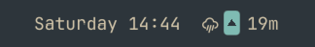
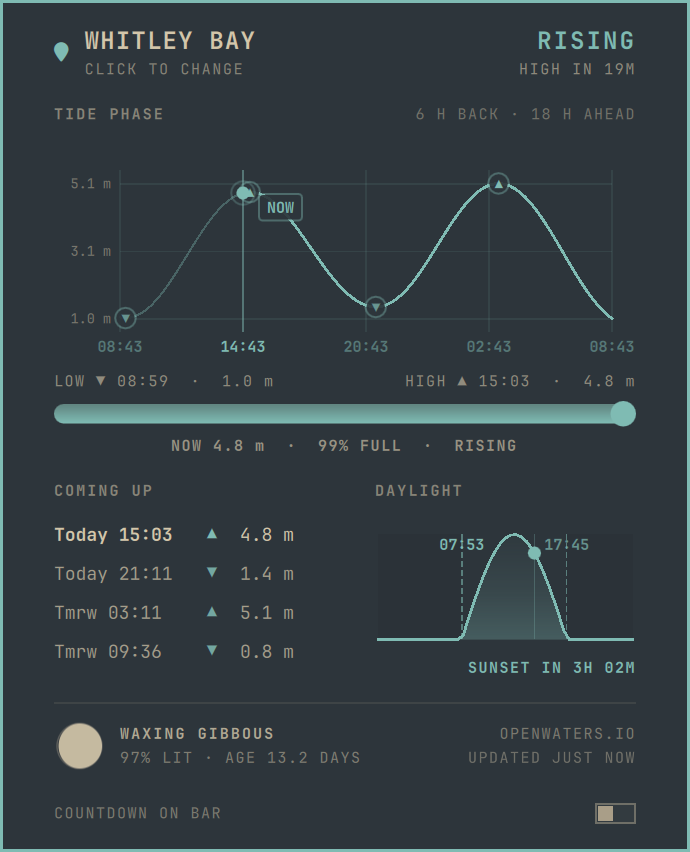

# OmaTide

**Know the tide without leaving your desktop.**

Planning a swim, a surf, a beach walk or time on the boat? OmaTide puts the sea on your [Omarchy](https://omarchy.org/) bar. A small water gauge shows how high the tide is right now and whether it's coming in or going out, with a countdown to the turn. Click it for the full picture: the tide curve, the next highs and lows, daylight, and the moon.



## Everything at a glance



- **Bar gauge.** A small water column fills from low to high water, with a ▲ or ▼ for rising or falling. Next to it is the time left until the tide turns: a ▼ with `5h13` means "falling, low water in 5 hours 13 minutes". Hover it for the place, the current height and the exact time of the next high or low.
- **Headline.** The place, whether the tide is rising or falling, and the countdown ("HIGH IN 19M").
- **Tide curve.** The water level from 6 hours ago to 18 hours ahead, with a NOW marker, ▲/▼ badges on every high and low, and a height scale. Below it, a gauge shows how full the tide is right now ("99% FULL").
- **Coming up.** The next four highs and lows, with day (Today, Tmrw or weekday), time and height. On coasts with a small tidal range, heights get two decimals so the readings stay distinct.
- **Daylight.** The sun's arc for the day, with sunrise and sunset times, night shading and a dot for the sun's position right now. It counts down to sunset, or after dark to sunrise.
- **Moon phase.** A drawn moon with its phase, how much is lit and its age in days.

## Built for the real coast

- **Anywhere with a tide.** Search for any coastal town as you type. Tide finds the nearest published tide station, so even an inland pick gives you the closest shore.
- **Local times, always.** Every time is the clock at the place you picked, not your computer's. If they differ, the panel says so under the location name ("TIMES UTC+2"), so tides abroad aren't off by hours.
- **Works offline.** Tide data and sunrise and sunset times are cached for each location. With no connection, the panel keeps working from the cache and says "CACHED DATA".
- **Matches your theme.** The bar gauge and panel accents follow your active Omarchy theme.
- **Stays out of the way.** Turn off "Countdown on bar" at the bottom of the panel to show only the gauge. Your choice is remembered.

## Install

```sh
omarchy plugin add https://github.com/Gnosis80s/OmaTide.git --enable
```

That's all. The command downloads the plugin, checks it against Omarchy's plugin format, installs it to `~/.config/omarchy/plugins/gnosis.tide/` and adds it to the center of your bar. The bar reloads without restarting the shell.

The first time you open the panel, it asks you to pick a location. Search for your nearest coastal town.

If it isn't on the bar after installing:

```sh
omarchy plugin enable gnosis.tide --section center
```

To update to the latest version:

```sh
omarchy plugin update gnosis.tide
```

### Requirements

- An **Omarchy** system (Hyprland and the Omarchy shell).
- `curl`, `bash` and GNU `date`, all standard on Arch.
- Internet access to `api.openwaters.io` (tides) and `api.open-meteo.com` (place search, sunrise and sunset), at least once per location.

## Controls

| Action | What it does |
| --- | --- |
| **Left click** | Open or close the tide panel |
| **Middle click** | Refresh the tide data |
| **Hover** | Show the place, rising or falling, the current height and the time of the next high or low |
| **Click the location** (in the panel) | Search for a new place; your pick is remembered |
| **Countdown on bar** (in the panel) | Show or hide the countdown next to the gauge |

## Data and storage

- Tide extremes and the tide curve come from the [Open Waters](https://openwaters.io) tide API. Place search and sunrise and sunset come from [Open-Meteo](https://open-meteo.com).
- Cached data is saved to `~/.local/state/omarchy/settings/gnosis-tide-<location>-<coords>-*.json`. Your location is saved to `gnosis-tide-location.json` and the countdown setting to `gnosis-tide-prefs.json`. The panel footer shows how fresh the data is ("UPDATED 3M AGO", or "CACHED DATA" when offline).

## Files

```
gnosis.tide/
├── manifest.json     # Plugin manifest (id, entry point, bar-widget metadata)
├── BarWidget.qml     # Bar gauge: tide level, direction, countdown and hover tooltip
├── Panel.qml         # Panel: location search, tide curve, coming up, daylight, moon
├── Model.js          # Tide API parsing, place search, interpolation, sun and moon maths
└── test/             # Model.js unit tests
```

## Development

`Model.js` doesn't depend on the shell, so its logic is tested with Node:

```sh
node --test test/
```
